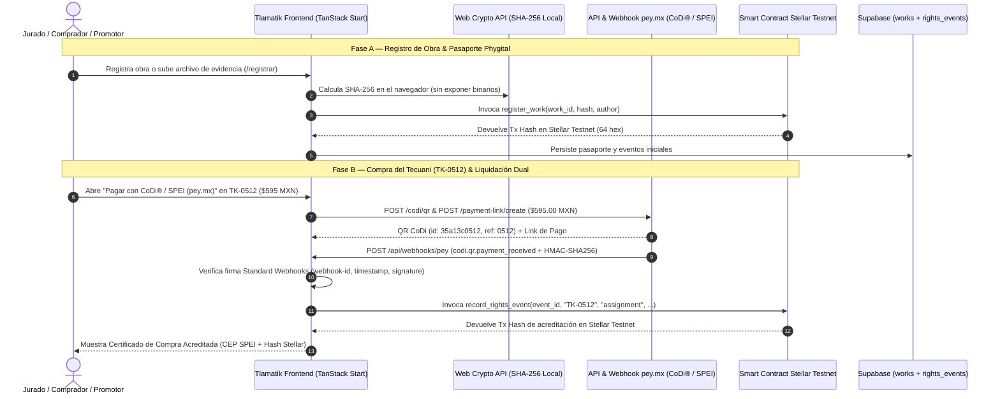

# Guía de Evaluación End-to-End (E2E) para el Jurado — Tlamatik · Pasaporte Cultural & Comercio Justo

> **Propósito de este documento**: Guiar al jurado paso a paso a través de una prueba integral **End-to-End (E2E)** de **Tlamatik**, validando desde el registro criptográfico de una pieza artesanal en **Stellar Soroban Testnet**, hasta su compra mediante **CoDi® / SPEI (`pey.mx`)**, la recepción del **Webhook firmado (HMAC-SHA256)** y la **acreditación dual on-chain + bancaria** sin intermediarios.

---

## 1. Arquitectura E2E que Evaluará el Jurado



### Identificadores Técnicos en Vivo (Stellar Testnet & `pey.mx`)

| Componente | Valor / Identificador |
| :--- | :--- |
| **Red Blockchain** | `Stellar Testnet` (`Test SDF Network ; September 2015`) |
| **Smart Contract ID (Soroban)** | `CAOAFGPATXWJ6KKGXFYHY42Q4N75NOWSR3NH3K2DT7QR3YSMDGT5P2HO` |
| **WASM Hash Desplegado** | `ba7d1753ecf002984aee4a87c80b64af6bc1a819ed27bfa98162a9b4cfd2bcaa` |
| **Explorador del Contrato** | https://stellar.expert/explorer/testnet/contract/CAOAFGPATXWJ6KKGXFYHY42Q4N75NOWSR3NH3K2DT7QR3YSMDGT5P2HO |
| **Tx Hash Ejemplo (`register_work`)** | `725e126cc7998b795f328f99e9ba60d863202d06aa1166016d0cd573eadd48cf` |
| **Tx Hash Ejemplo (`record_rights_event`)** | `30f6f7e9a1df1187d0a6c57ba86eaecebafcb4d8e2af7e12930a160930359199` |
| **Pieza Insignia para Compra E2E** | `TK-0512` — *El Guardián del Monte: Tecuani de Acatlán* (`$595.00 MXN`) |
| **Endpoint Webhook `pey.mx`** | `POST /api/webhooks/pey` (salud y esquema en `GET /api/webhooks/pey`) |

---

## 2. Preparación del Entorno (1 minuto)

Si el jurado evalúa la aplicación localmente:

1. Instalar dependencias e iniciar el servidor de desarrollo:
   ```bash
   npm install
   npm run dev
   ```
2. Abrir en el navegador: `http://localhost:8080` (o el puerto que indique la terminal, por ejemplo `http://localhost:3000`).

---

## 3. Recorrido Paso a Paso para el Jurado (5 Escenarios E2E)

### Escenario 1: Compra de la Figura del Tecuani (`TK-0512`) vía `pey.mx` + Webhook + Smart Contract Stellar

**Objetivo**: Comprobar cómo el cobro en pesos mexicanos (`$595.00 MXN`) dispara el webhook de `pey.mx`, ejecuta automáticamente el Smart Contract en **Stellar Testnet** y entrega al comprador el comprobante con ambos acuses (bancario y blockchain).

1. **Ir al Mercado o Verificador**:
   - Navegar a `/mercado` o abrir directamente el pasaporte del Tecuani en `/verificar?id=TK-0512`.
2. **Abrir la Pasarela CoDi® / SPEI (`pey.mx`)**:
   - En la tarjeta de **"El Guardián del Monte: Tecuani de Acatlán"** (`TK-0512`), hacer clic en el botón verde **"Pagar con CoDi® / SPEI (pey.mx)"**.
3. **Revisar la Orden y el Desglose Transparente**:
   - **Valor de la Obra Artesanal**: `$450.00 MXN` (`95.2%` = **`$428.40 MXN`** netos directos para el Maestro *Ángel Domínguez Ríos*, Acatlán de Osorio, Puebla).
   - **Certificado Phygital (QR/NFC + Soroban)**: `$25.00 MXN`.
   - **Envío Asegurado y Embalaje**: `$120.00 MXN`.
   - **Total a Liquidar**: **`$595.00 MXN`**.
4. **Disparar el Evento de Pago Exitoso (Webhook + Smart Contract)**:
   - Hacer clic en **"Simular Pago Exitoso (Webhook pey.mx → Smart Contract Stellar)"**.
   - Observar la ejecución en 3 etapas:
     1. `1/3 · Evento Webhook de pey.mx recibido y verificado (HMAC-SHA256)`
     2. `2/3 · Ejecutando Smart Contract Soroban en Stellar Testnet (record_rights_event)…`
     3. `3/3 · Generando comprobante dual (SPEI Banxico + Hash Stellar)`
5. **Auditar el Certificado de Compra Acreditada**:
   - Verificar en pantalla los datos de ambos eventos:
     - **Evento 1 (`pey.mx` · SPEI)**: `Webhook ID` (`HMAC-SHA256 OK`), `Transaction ID`, `CoDi QR ID` (`35a13c0512`), `Referencia` (`0512`) y **Clave de Rastreo SPEI (CEP Banxico)**.
     - **Evento 2 (`Stellar Testnet · Soroban`)**: `Contract ID` (`CAOAFGPATXWJ6KKGXFYHY42Q4N75NOWSR3NH3K2DT7QR3YSMDGT5P2HO`), función `record_rights_event (assignment)`, `Event ID On-Chain`, **Hash de Transacción Stellar Testnet (64 hex)** y **Hash SHA-256 de la Pieza / Pasaporte (64 hex)**.
6. **Descargar el Certificado y Verificar en Stellar Expert**:
   - Hacer clic en **"Descargar Certificado"** y en **"Ver en Stellar Expert ↗"**.

---

### Escenario 2: Verificación Pública y Auditoría Binaria SHA-256 (`/verificar`)

1. Ir a `/verificar`.
2. Seleccionar `TK-0512`, `TK-0042` o `TK-0108`, o pegar un hash SHA-256 de 64 caracteres.
3. Revisar la sección **"Historial de Derechos y Evidencia (Soroban Rights Events)"** (`registration`, `evidence`, `license`, `assignment`).
4. Hacer clic en **"Auditar archivo local (SHA-256)"** y subir cualquier archivo para comprobar el cálculo SHA-256 en el navegador.

---

### Escenario 3: Registro de Promotor Comunitario (`/promotor`)

1. Ir a `/promotor`.
2. Completar los campos del expediente y observar el avance porcentual y la **Vista Previa de Credencial en Vivo**.

---

### Escenario 4: Registro Criptográfico de una Nueva Obra (`/registrar`)

1. Iniciar sesión en `/auth` y navegar a `/registrar`.
2. Completar los 3 pasos (*Datos de la Pieza*, *Evidencia del Saber*, *Minting Criptográfico*) y anclar la obra en el contrato Soroban de Stellar Testnet.

---

### Escenario 5: Panel del Embajador y Monitor de Webhooks (`/panel`)

1. Navegar a `/panel`.
2. Probar el alta de artesano con **hash SHA-256 con sal para datos bancarios** y el **Monitor en Vivo de Webhooks `pey.mx` + SPEI**.

---

## 4. Prueba Técnica con `cURL` y Suite de Tests

```bash
# Consultar salud y eventos recientes del webhook
curl -s http://localhost:8080/api/webhooks/pey | jq .

# Ejecutar la suite completa de pruebas automatizadas
npm test
```

